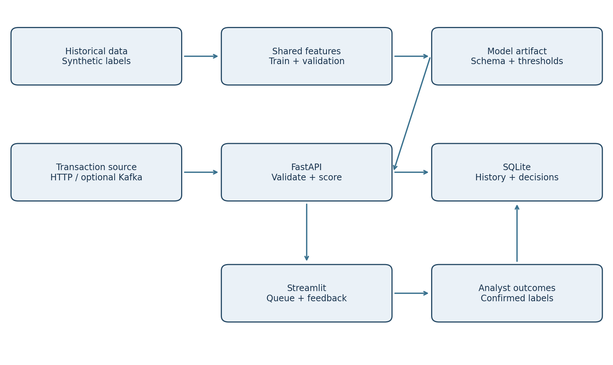

> Historical detailed project guide. The root README and repository inventory describe currently available files; older release notes may refer to external bundles or earlier versions.

# Real-Time Fraud Detection and Risk Scoring Platform

Python, SQL, machine learning, FastAPI and Streamlit portfolio project for Kavali Harshavardhan.

Scores incoming transactions and returns **approve**, **verify**, or **review**. These are demo decisions; no payment is actually approved or blocked.



## Quick start (Python 3.12 recommended)

Extract the ZIP, open the `fraud-platform` folder in VS Code and open its terminal.

```bash
python -m venv .venv
```

Windows PowerShell: `.venv\Scripts\Activate.ps1`. macOS/Linux: `source .venv/bin/activate`.

```bash
python -m pip install -r requirements.txt
python -m src.train
python -m pytest -q
python -m uvicorn src.api:app --host 127.0.0.1 --port 8000
```

Keep that terminal open. In a second activated terminal:

```bash
python -m streamlit run dashboard.py
```

Open http://localhost:8501. API documentation: http://localhost:8000/docs.
In a third activated terminal:

```bash
python -m src.simulate --count 300 --delay 0.1
```

The included dataset and model allow a quick demo. Always retrain after changing Python/scikit-learn versions. Load only trusted joblib files.

## What is included

| Folder/file | Purpose |
|---|---|
| `src/generate.py` | Reproducible 12,000-row synthetic transaction generator |
| `src/features.py` | Shared point-in-time feature logic |
| `src/train.py` | Chronological split, two models, validation thresholds, holdout evaluation |
| `src/engine.py` | Persistent SQLite scoring, idempotency, history and feedback |
| `src/api.py` | Validated FastAPI endpoints |
| `src/simulate.py` | Transaction replay through HTTP |
| `dashboard.py` | Automatically refreshed review dashboard and manual scoring |
| `src/kafka_bridge.py` | Optional Kafka producer/consumer bridge |
| `src/monitor.py` | Reference-versus-current feature shift report |
| `sql/` | Schema and analytical queries |
| `notebooks/EDA.ipynb` | Re-runnable exploratory analysis |
| `reports/` | Measured metrics, predictions, plots, test results and Excel workbook |
| `docs/` | Full guide, PDF, architecture, workflow, model card and interview notes |
| `tests/` | API and data-integrity tests |
| `compose.yaml` | Local API/dashboard containers with persistent state |

## Measured synthetic holdout results

7,200 training / 2,400 validation / 2,400 test rows, ordered by time.
Selected model: **random_forest**, based only on validation average precision.

| Metric | Result |
|---|---:|
| Test fraud prevalence | 1.25% |
| Average precision | 0.1807 |
| Recall at verify threshold | 53.33% |
| Precision at verify threshold | 5.59% |
| False-positive rate | 11.39% |
| Alert rate | 11.92% |
| Fraud amount captured by alerts | 86.49% |

The model misses 14 of 30 synthetic fraud events and raises 270 false alerts. This is a learning baseline, not production evidence. Average precision is the discrete AP metric, not trapezoidal PR-AUC. Score = 100 times model output; it is **not a calibrated probability**.

## Workflow

Define event contract -> generate labeled synthetic transactions -> validate -> calculate historical features -> split 60/20/20 by time -> train -> choose model and thresholds on validation -> evaluate once on holdout -> score HTTP events -> store decisions -> display queue -> collect outcomes -> monitor -> retrain under review.

## Local containers

```bash
docker compose up --build
```

Docker files are supplied; container execution is separate from the verified Python run. Bindings are local-only. Do not expose this unauthenticated demo to the public internet.

## Optional Kafka

See `docs/KAFKA.md`. The HTTP simulator is the default working path. Kafka requires your own broker and `requirements-kafka.txt`; a broker is not bundled or hosted.

## Reproduce data and evaluation

```bash
python -m src.generate
python -m src.train
python -m src.monitor
```

Seed 42. All amounts are INR, timestamps UTC, and identities synthetic. Labels are sampled by the generator's artificial process. No external dataset or real customer information is used.

## State and limitations

A new live database has no customer history. Replay from the beginning to warm it. Do not compare cold-start scores directly with holdout scores, whose features include preceding history. Replay is idempotent; changed payloads under the same ID return 409. Events must be strictly ordered per customer; late events return 409. After manually scoring current-time events, use a fresh database to replay historical events for that customer (`FRAUD_DB` environment variable).

SQLite serializes scoring writes. Full per-customer history scans are suitable for a small demo. Kafka/Redis/PostgreSQL scaling, calibration, real labels, authentication, load tests, and public hosting are not claimed complete.

Full explanation: [Project guide](docs/PROJECT_GUIDE.md). Printable report: [PDF](docs/Fraud_Platform_Guide.pdf). Workbook: [Excel](reports/Fraud_Analytics.xlsx).
